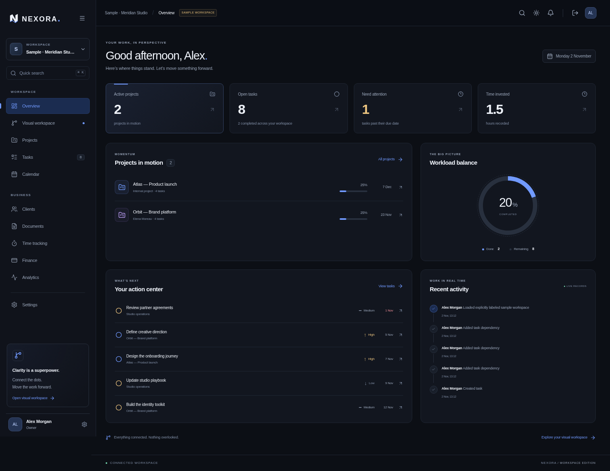
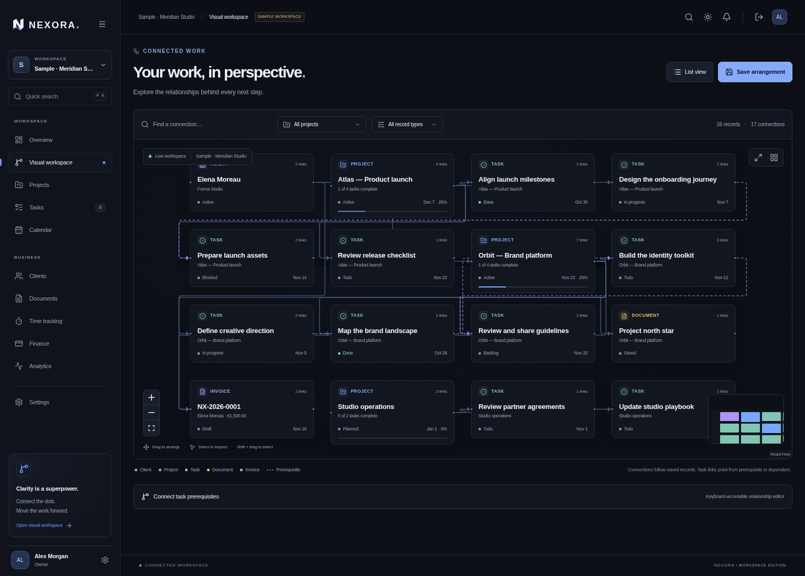

# NEXORA

NEXORA is a self-hosted workspace for connected projects, tasks, clients, documents, time, and invoices. Its visual workspace renders the same persisted records and relationships used by the conventional views.

This application lives in `nexora/` inside the existing SQL documentation repository. The original teaching materials are independent and remain unchanged. NEXORA uses SQLite; it does not use the teaching environment's MySQL container.

## Requirements and local setup

- Node.js 24.x
- pnpm 11.25.0 (declared in `packageManager`)
- A writable local directory for the SQLite database
- A C++ build toolchain and Python only if the native SQLite package cannot obtain a compatible prebuilt binary

From this directory:

```sh
corepack enable
corepack prepare pnpm@11.25.0 --activate
pnpm install --frozen-lockfile
cp .env.example .env.local
```

Generate a private secret with `openssl rand -base64 48` and place it in `.env.local` as `BETTER_AUTH_SECRET`. Set `BETTER_AUTH_URL=http://localhost:3000` for the local origin. Keep `.env.local` out of version control. The development server can generate a local signing secret when none is set, but deployment requires an explicitly provided unique secret.

```sh
pnpm db:migrate
pnpm dev
```

Open the application at `http://localhost:3000`, create an account, and create a workspace. Start with an empty workspace or explicitly choose the labeled demonstration workspace. Demo records are fictional and their metrics are calculated from the seeded database records. There is no shared public account or default password.

Each cloud task is already isolated. Develop in the existing checkout; do not create a Git worktree unless specifically requested.

## Local signup troubleshooting

For local development, the app defaults to `http://localhost` on the actual port printed by Next.js. A `.env.local` file is optional in development; the database and private signing secret are created automatically when needed. If you explicitly set `BETTER_AUTH_URL`, it must exactly match the browser's scheme, hostname and port.

Older downloads could reject signup with HTTP 403 because Next exposes an internal `0.0.0.0` request URL. Update the `nexora/initial-release` branch, or add this line to `.env.local` beside `package.json` for a server running on port 3000:

```env
BETTER_AUTH_URL=http://localhost:3000
```

Stop the development server with Ctrl+C, restart `pnpm dev`, and open that exact address. Preserve any other settings and your existing `data/` directory. An unauthenticated `GET /api/workspaces` returning 401 on the sign-in screen is expected; a signup POST returning 403 is a separate origin/configuration problem.

## Commands

| Command             | Purpose                                                         |
| ------------------- | --------------------------------------------------------------- |
| `pnpm dev`          | Development server on port 3000                                 |
| `pnpm build`        | Production compilation and route generation                     |
| `pnpm start`        | Serve the production build                                      |
| `pnpm typecheck`    | Strict TypeScript checks                                        |
| `pnpm lint`         | ESLint checks                                                   |
| `pnpm format:check` | Check formatting                                                |
| `pnpm test`         | Domain and SQLite integration tests                             |
| `pnpm test:e2e`     | Playwright browser workflows                                    |
| `pnpm db:migrate`   | Apply explicit, idempotent database migrations                  |
| `pnpm db:seed`      | Optional sample workspace seeding for your development identity |
| `pnpm db:backup`    | Consistent private online SQLite backup                         |
| `pnpm notices`      | Refresh installed production dependency notices                 |

Browser tests reuse `/usr/bin/chromium` when available. Set `PLAYWRIGHT_CHROMIUM_EXECUTABLE_PATH` to use another installed Chromium binary. If neither is available, install Playwright’s browser and OS dependencies:

```sh
pnpm exec playwright install --with-deps chromium
pnpm build
pnpm test:e2e
```

After the production build, Playwright starts a separate application on port 3100 with its own test database. It must not point to a production database. `test-results/` and browser reports are generated outputs. The implementation record in [docs/IMPLEMENTATION_STATUS.md](docs/IMPLEMENTATION_STATUS.md) distinguishes checks actually executed from merely available test commands.

## Configuration

| Variable                                   | Purpose                                                                      |
| ------------------------------------------ | ---------------------------------------------------------------------------- |
| `BETTER_AUTH_SECRET`                       | Private, randomly generated session-signing secret; required for deployment  |
| `BETTER_AUTH_URL`                          | Exact canonical application origin, including scheme and port where relevant |
| `DATABASE_PATH`                            | SQLite file path; use durable storage, for example `./data/nexora.sqlite`    |
| `SEED_EMAIL`, `SEED_PASSWORD`, `SEED_NAME` | Optional local seeding identity; use development credentials only            |

The application needs no paid APIs, external identity service, email provider, analytics tracker, or model API. Regular use is online against your application server. Full offline editing and synchronization are not implemented.

## Architecture and product scope

NEXORA is a modular monolith: Next.js App Router and React with strict TypeScript, Better Auth for credential authentication and sessions, parameterized SQLite repositories, and React Flow for the graph. Design tokens and accessible native controls form the interface foundation. See [architecture](docs/ARCHITECTURE.md) and [security](docs/SECURITY.md).

The working modules and verification status are tracked in [the implementation record](docs/IMPLEMENTATION_STATUS.md). Some requirements in the longer product directive remain future work. Do not infer support for invitations by email, external integrations, arbitrary automations, comprehensive accounting, rich-text collaboration, attachments, or offline synchronization from the navigation or underlying architecture.

Financial amounts use integer minor units and explicit currencies. Invoice output is operational record keeping, not a guarantee of compliance with every jurisdiction's tax or invoicing law.

## Production deployment

```sh
pnpm build
NODE_ENV=production pnpm start
```

Provide a unique `BETTER_AUTH_SECRET`, an HTTPS `BETTER_AUTH_URL`, a persistent `DATABASE_PATH`, and a TLS reverse proxy. Expose the application through that origin; do not expose the SQLite file. Terminate HTTPS at a trusted proxy and preserve the canonical host and request origin. Review [the security assumptions](docs/SECURITY.md) before allowing untrusted users.

The Docker image uses Next.js standalone output and a non-root runtime user:

```sh
docker build -t nexora .
docker volume create nexora-data
docker run --name nexora -p 3000:3000 \
  --env-file .env.production \
  -e DATABASE_PATH=/app/data/nexora.sqlite \
  -v nexora-data:/app/data \
  nexora
```

Create `.env.production` outside version control, containing your production `BETTER_AUTH_SECRET` and `BETTER_AUTH_URL`. A configured HTTPS reverse proxy is required for public deployment. A successful local build does not establish that a public deployment has been reviewed or tested.

In a managed cloud environment, follow its Docker proxy and CA instructions. When HTTPS package installation requires the provided CA, pass it without baking the session certificate into an image:

```sh
docker build --secret id=proxy_ca,src="$CODEX_PROXY_CERT" -t nexora .
```

Keep normal TLS and package checksum verification enabled.

## Account recovery

A verified deployment operator can reset a local account with `node --import tsx scripts/reset-password.ts` after securely supplying `RECOVERY_EMAIL` and `RECOVERY_PASSWORD` as environment variables. This invalidates existing sessions. See [the security guide](docs/SECURITY.md#account-recovery) for the procedure and trust assumptions. No email password-reset service is configured.

## Backup and restore

SQLite is configured with foreign keys, WAL mode, and a busy timeout. A database can have active `-wal` and `-shm` files. Do not copy only the main file while writers are running.

For a consistent online backup, use the included command:

```sh
pnpm db:backup
```

It uses SQLite's online backup API, writes a new file under `data/backups/` by default, refuses to overwrite an existing destination, and restricts the backup file's permissions. Set `BACKUP_PATH` to choose a different new destination. This command requires no separate SQLite CLI installation.

Alternatively, stop the application before copying the database and its associated files. Encrypt backups at rest, restrict filesystem permissions, and test restoration on a separate instance. To restore, stop the application, preserve its current database, restore the chosen consistent backup to `DATABASE_PATH`, set ownership for the application user, and restart. Keep the corresponding deployment configuration and session secret secure; rotate secrets and invalidate sessions if a backup may have been exposed.

SQLite suits a single application instance with modest concurrent writes. Network filesystems and multiple independent writers are outside this initial deployment model. PostgreSQL migration will require repository/transaction and SQL migration changes; it is not an environment-variable switch.

## Dependency notices and product licensing

[THIRD_PARTY_NOTICES.txt](THIRD_PARTY_NOTICES.txt) preserves the included license/notice texts collected from the installed production dependency graph. [The dependency inventory](docs/third-party/dependency-inventory.json) records package names, versions, declared licenses, and source metadata. Regenerate both after a dependency change with `node scripts/collect-notices.mjs`. The container includes these notices. This inventory is not an independent legal review. The installed graph includes LGPL-licensed libvips binaries, MPL-licensed Lightning CSS, and CC-BY browser data alongside MIT/ISC/BSD/Apache packages. Preserve their notices and review applicable attribution, source-availability, and redistribution terms before commercial distribution.

No first-party distribution license has been selected for NEXORA. The presence of source code does not itself grant a commercial redistribution license. Choose and document that license before distributing the product.

## Verified interface

The screenshots below use an explicitly labeled fictional sample workspace; their metrics and graph connections come from persisted sample records.





See [the full implementation and test record](docs/IMPLEMENTATION_STATUS.md) for completed workflows and remaining work.
